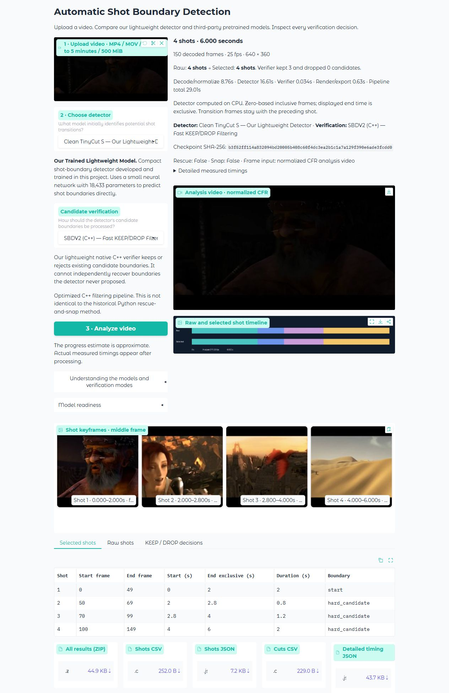
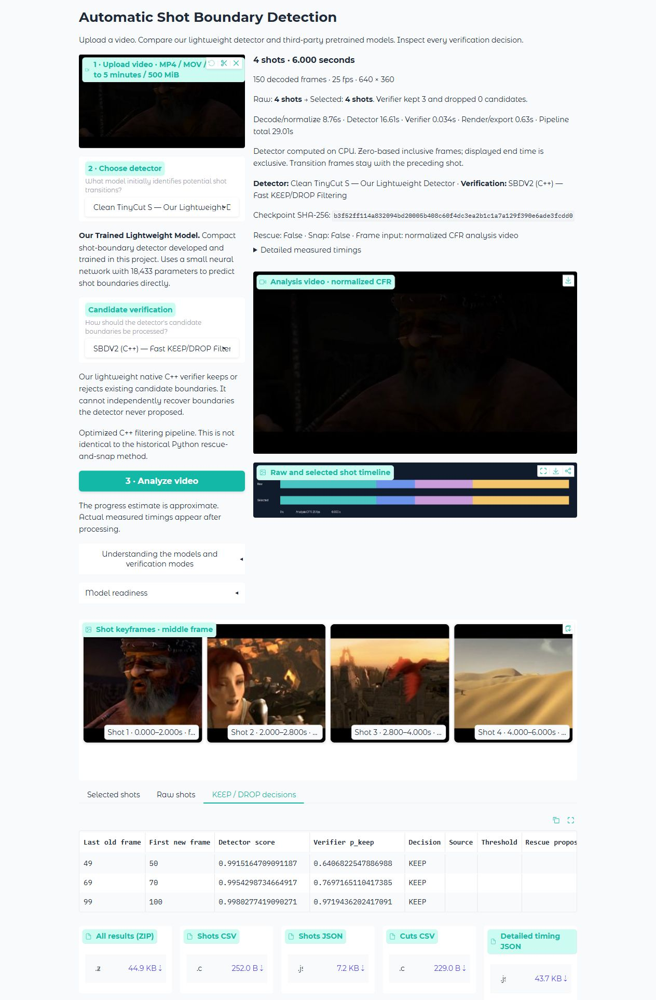

> Windows portability repair: see [PORTABLE_WINDOWS_README.md](PORTABLE_WINDOWS_README.md) and the [final controlled fixes](CONTROLLED_PORTABILITY_NOTES.md). Never distribute a prebuilt .venv; setup validates and repairs environments safely.

# Automatic Shot Boundary Detection

A Windows CPU application for finding shot transitions in video, comparing raw detector proposals with learned verification, inspecting shot/keyframe tables, and exporting reproducible CSV/JSON diagnostics.

**This is the final faculty application's implementation, with public-release packaging and documentation.** Its UI is titled **Automatic Shot Boundary Detection**. Omni v1.5 is labelled **52.8M (Newer Version)**; its Python option is **Python Verifier — Higher Accuracy, Slower**. The last label reflects historical apparent evaluation, not guaranteed superiority on new videos.

**Public source and faculty archive:** this repository contains the reviewed implementation and public assets, not the complete academic submission ZIP. Large third-party checkpoints, FFmpeg binaries, private recordings and local audit data remain excluded. Follow the provisioning steps below before installation verification; cloning alone does not reproduce the complete faculty archive. The final deployment fixes add deterministic native-build discovery, ZIP safety checks that remain active under `python -O`, and a native DLL/CLI operation check. They preserve detector/verifier algorithms and model identities. See [validation scope](docs/VALIDATION.md); independent second-PC testing remains **NOT TESTED**.

> **Read before installing:** the AutoShot pretrained checkpoint is not included or automatically downloaded. You must obtain the exact file from its original authors. The two Omni models are downloaded from their official immutable Hugging Face releases. Installation is not fully offline. See [model provisioning and rights](docs/MODELS.md).

## What this project does

A shot is a continuous camera segment. Shot-boundary detection finds cuts and gradual transitions so long videos can be split, indexed or reviewed. The application combines published pretrained detectors with our compact **Clean TinyCut S**, our historical fitted Python verifiers and our native C++ SBDV2 candidate filter. Verification can remove false proposals; Python can additionally propose lower-confidence/rescue candidates where supported. Filtering can also remove correct boundaries.

AutoShot and OmniShotCut architectures/weights belong to their original researchers. Our work is TinyCut training/integration, candidate-verification experiments, C++ SBDV2, application engineering, evaluation and archival integrity analysis. We do not claim to have invented compact neural shot detection or candidate filtering.

## Implemented features

- Upload MP4, MOV or AVI and select one of four CPU detectors.
- Compare Raw with supported Python or C++ verification.
- Inspect hard/gradual candidate intervals, native Omni labels, KEEP/DROP probabilities, thresholds, rescues and snap coordinates.
- View normalized preview, raw/selected timeline, middle-frame keyframes and shot interval tables.
- Download shots CSV/JSON, cuts CSV, detailed timing JSON and a result ZIP with metadata, raw shots, provenance, cuts JSON, timeline and thumbnails.
- Preserve original Python gradual-transition gaps; inspect source-to-analysis frame correspondence.
- Reuse detector inference through content-based caching when switching verification.

The preview is normalized video, **not an annotated-video renderer**. This application processes uploaded clips; it is not a certified real-time streaming product.

## Screenshots and example



The screenshot is captured from the running application using the included **Sintel** engineering montage. It demonstrates the UI and exports, not independent benchmark accuracy. The six-second, 150-frame example is derived from the Blender Foundation trailer under CC BY 3.0; attribution and exact edits are in [examples/README.md](examples/README.md). No SHOT200, BBC, advertisement or other unlicensed evaluation footage is included.



## Requirements

| Component | Supported/tested configuration |
|---|---|
| OS | Windows x64; tested on Windows 11. Windows 10 is the intended installation target but not separately certified. |
| Python | 64-bit Python 3.13; tested 3.13.5. |
| Compute | CPU PyTorch 2.11.0+cpu / torchvision 0.26.0+cpu. GPU/CUDA operation is not certified. |
| Packages | Pinned requirements.txt and requirements-lock.txt, including NumPy 2.1.3, SciPy 1.16.2, sklearn 1.6.1, joblib 1.4.2, Gradio 6.31.0, OpenCV headless 4.12.0.88. |
| Native tools | Bundled Windows SBDV2 DLL/EXE; no compiler needed for normal operation. Source/build scripts included for inspection. |
| Video tools | FFmpeg and FFprobe; the included bootstrap fetches and verifies Gyan's pinned Windows 9.0.2 archive. |
| Network | Initial dependency/model/tool acquisition; normal inference then runs locally. |

An x64 CPU, 8 GB RAM and 8 GB free disk are engineering recommendations inherited from the faculty deployment, **not measured minimum requirements**. Larger clips can require more memory/time. Upload limits: 500 MiB, 5 minutes, 3840x2160, 1–60 fps. Omni additionally limits decoded model input to 256 MiB. Use a short writable checkout path.

## Installation: Windows PowerShell

### 1. Clone and create the isolated environment

Install Git and 64-bit Python 3.13 first. Then:

```powershell
git clone https://github.com/shubhang191/automatic-shot-boundary-detection.git
cd automatic-shot-boundary-detection
py -3.13 -m venv .venv
.\.venv\Scripts\Activate.ps1
python -m pip install -r requirements.txt -c requirements-lock.txt
```

If activation is blocked, do not change your system execution policy just for this project. Use `.\.venv\Scripts\python.exe` instead of `python` in the following commands. Dependency pins are intentional; avoid individual upgrades, especially scikit-learn. The CPU PyTorch index is specified in requirements.txt. No separate CUDA instructions are supplied because that configuration has not been tested.

### 2. Obtain the required AutoShot checkpoint

Open the [AutoShot authors' README](https://github.com/wentaozhu/AutoShot) and follow its pretrained-model link. The documented author-hosted [Baidu share](https://pan.baidu.com/s/1CdCVNzFdF3U6I4ajfejYNQ?pwd=sfkq) uses extraction code `sfkq`; account/client access may be required. Download **ckpt_0_200_0.pth**, not a similarly named architecture or prediction pickle.

```powershell
New-Item -ItemType Directory -Force downloads
```

Save the lawfully obtained file as `downloads\ckpt_0_200_0.pth`. The required SHA-256 is:

```text
3e85290546ce6d32f4a3581ec2cae87aedd2402246a0d46b4d361a330b4b1fa6
```

This is a genuine manual prerequisite; no automatic or unrestricted availability is promised. See [MODELS.md](docs/MODELS.md) if access fails. The application does not accept substitute weights or silently switch models.

### 3. Prepare models, tools and verify installation

```powershell
python scripts/prepare_models.py --autoshot downloads/ckpt_0_200_0.pth
python scripts/bootstrap_ffmpeg.py
python scripts/validate_environment.py
python -m pip check
```

The first command downloads **official Preview and v1.5 weights**, verifies immutable file hashes, and installs the verified AutoShot file. Small project-created TinyCut/verifier artifacts are already bundled. Model loading never retrains or retunes anything. Bootstrap keeps upstream FFmpeg license information locally. Installation verification must end with status PASS; do not ignore missing/mismatched assets.

Alternatively, after preparing models, `setup.bat` creates/uses .venv, installs the same pinned requirements, bootstraps FFmpeg and runs verification. It does not bypass the manual AutoShot prerequisite.

### 4. Launch

```powershell
.\run.bat
```

The launch script checks the environment and opens the browser. The local URL normally is **http://127.0.0.1:7860**; if occupied, the app chooses the next free port through 7879 and prints the actual URL. It binds to localhost with no public Gradio tunnel. Keep the terminal open; Ctrl+C stops the server.

For a headless launch:

```powershell
python app.py --no-browser --port 7860
```

## Using the interface

1. Upload `examples/inputs/sintel excerpt.mp4` or a video you may lawfully process.
2. Select the detector, then a supported candidate-verification mode.
3. Click **Analyze video** and wait for measured processing results.
4. Compare Selected/Raw shots, keyframes, timeline and KEEP/DROP diagnostics.
5. Download individual exports or **All results (ZIP)**. Detailed timing JSON is separate.

Zero-based shot starts/ends refer to analysis frames. End-frame numbers are inclusive; displayed end timestamps are exclusive. Python can retain gaps for gradual transitions. Do not silently fill those gaps. Candidate/native labels are model outputs, not ground-truth transition categories. Exports record model/checkpoint/bundle hashes and preprocessing provenance.

## Supported detector and verifier combinations

| Detector / stable ID | Raw | C++ SBDV2 | Python |
|---|---|---|---|
| Clean TinyCut S / tinycut | Yes | Yes | **Unsupported** |
| AutoShot / autoshot | Yes | Yes | Learned verification with original + low-confidence proposals |
| OmniShotCut Preview 41M / omnishotcut | Yes | Yes | Original Omni rescue + snap; cross-version experiment |
| OmniShotCut v1.5 52.8M / omnishotcut_legacy_v15 | Yes | Yes | Original Omni rescue + snap; historical Review 1 configuration |

These **11 combinations are actually supported** by this application; no inference is made solely from the historical benchmark's mode count. Raw returns detector proposals. C++ SBDV2 is a frozen 60-tree classifier on 30 local candidate features: it **keeps/drops existing proposals and cannot recover missing ones**. Python uses the original fitted models; AutoShot expands its candidate pool, while Omni can add rescue proposals and snap accepted hard boundaries within three frames. Unsupported combinations raise an error.

TinyCut is a clean single network with **18,433 parameters**, 31 selected frame-derived temporal features and frozen decoding. It is not the older five-member ensemble. Preview (40,990,775 parameters) is the older official model; v1.5 (52,772,087) is the newer official release. Neither is guaranteed to be more accurate for every video.

## Historical SHOT200 results

The archived study uses **200 videos and 2,516 annotated transition events** with the locked interval scorer. Results are descriptive historical evidence; the packaging smoke test is separate. Full TP/FP/FN, precision, recall and F1 for all eleven rows are in [RESEARCH_RESULTS.md](docs/RESEARCH_RESULTS.md) and [CSV](docs/historical_results.csv).

| Configuration | Precision | Recall | F1 |
|---|---:|---:|---:|
| AutoShot Raw | .8477 | .8339 | .8407 |
| AutoShot C++ | .9092 | .8279 | .8667 |
| AutoShot Python (apparent) | .9046 | .8740 | .8890 |
| Clean TinyCut S Raw | .8318 | .8335 | .8326 |
| Clean TinyCut S C++ | .8918 | .8259 | .8576 |
| Historical Preview archive Raw | .7670 | .8021 | .7841 |
| Historical Preview archive C++ | .8941 | .7921 | .8400 |
| Historical Preview archive Python (apparent) | .8943 | .8613 | .8775 |
| Omni v1.5 Raw | .7680 | .7790 | .7735 |
| Omni v1.5 C++ | .8977 | .7707 | .8293 |
| Omni v1.5 Python (apparent) | .9084 | .8637 | .8855 |

**Limitations:** SHOT200 was reused during research; fitted Python evaluations may be in-sample. Independent source-disjoint evaluation was not completed. The historical Preview JSON lacks a creation-time checkpoint hash, even though the currently deployed Preview checkpoint is officially identified. Archived frame-count discrepancies and duplicate content were investigated, not silently repaired. No state-of-the-art or universal accuracy claim is made. See [LIMITATIONS.md](docs/LIMITATIONS.md).

## Tests and reproducibility

After successful provisioning:

```powershell
python -m pytest -q
python scripts/run_legacy_smoke_test.py --report reports/local/smoke.json
```

The existing suite exercises loaders, frozen probabilities/decoders, native bridge, feature/threshold integrity, timestamps, exports, invalid inputs, cache invalidation and UI mappings. The smoke script runs every supported combination on the licensed real video. Synthetic seed-3901 TinyCut data and numeric fitted-verifier fixtures are engineering tests, not an independent accuracy dataset. No benchmarks are regenerated to improve scores.

Runtime caches, models downloaded during setup, local reports and environments are ignored by Git. Gradio expires uploads separately. The pipeline cache defaults to .cache (four inputs / 4 GiB / 24h); `SBD_CACHE` may point to another writable location. Clearing your own cache recomputes predictions. See [ARCHITECTURE.md](docs/ARCHITECTURE.md) for identities and exports. Original backend and fitted-model bytes are preserved; .gitattributes prevents Windows newline conversion from breaking source integrity checks.

Packaging test results and their exact scope are recorded in [VALIDATION.md](docs/VALIDATION.md).

## Repository map

```text
app.py                    Gradio entry point
setup.bat / run.bat        Windows convenience scripts
src/sbd_app/              Pipeline, adapters, schema, video I/O, profiling, exports
src/legacy_python/        Original verifier modules and integrity-checked adapter
models/                   TinyCut, decoder, fitted Python bundles; pretrained paths
third_party/              Retained upstream sources/notices, SBDV2 source and binaries
scripts/                  Provisioning, FFmpeg bootstrap, checks and smoke tests
tests/                    Original regression tests and numeric/synthetic fixtures
examples/                 Licensed Sintel montage and attribution
docs/                     Architecture, installation, models, results and limitations
requirements*.txt         Tested CPU dependency pins
```

## Credits and licensing

- **AutoShot:** Wentao Zhu and colleagues, *AutoShot: A Short Video Dataset and State-of-the-Art Shot Boundary Detection*, CVPR Workshops 2023. [Original source/paper](https://github.com/wentaozhu/AutoShot).
- **OmniShotCut:** Boyang Wang and colleagues, *Holistic Relational Shot Boundary Detection with Shot-Query Transformer*. [Official source/model zoo](https://github.com/UVA-Computer-Vision-Lab/OmniShotCut).
- **TransNet V2:** Tomáš Souček and Jakub Lokoč, an effective deep network for fast shot-transition detection. [Original implementation](https://github.com/soCzech/TransNetV2). Its lineage is relevant to AutoShot; no separate TransNet V2 detector is offered here.
- PyTorch, Gradio, OpenCV, NumPy, SciPy, scikit-learn, FFmpeg, LLVM/MinGW and other dependencies retain upstream rights.
- **Sintel:** Blender Foundation, CC BY 3.0; see examples/README.md for source and modifications, including screenshot attribution.

There is deliberately no blanket project LICENSE: public inspection is authorized by the owner, but an open-source reuse license for project-owned components has not been selected. Third-party licenses are retained individually in [THIRD_PARTY_NOTICES.md](THIRD_PARTY_NOTICES.md) and third_party. AutoShot weights and copyrighted datasets are not redistributed.

For installation failures, see [TROUBLESHOOTING.md](docs/TROUBLESHOOTING.md).
